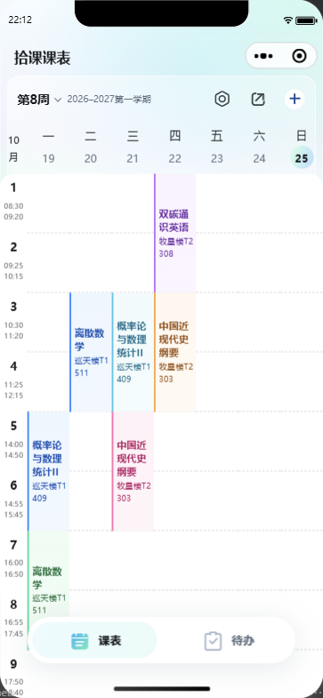
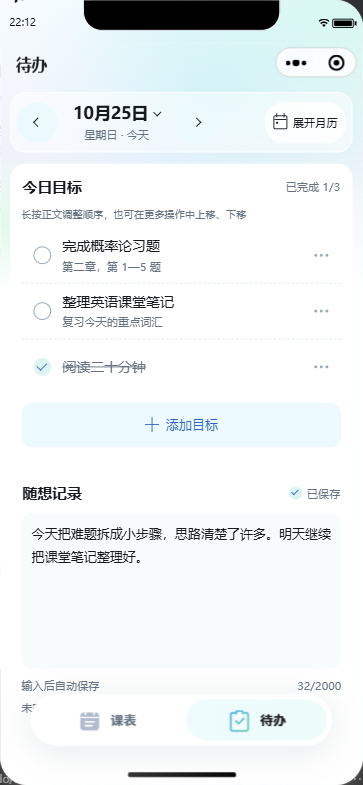
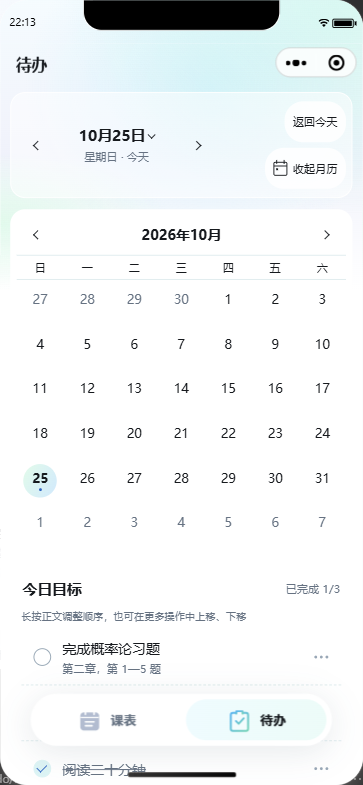
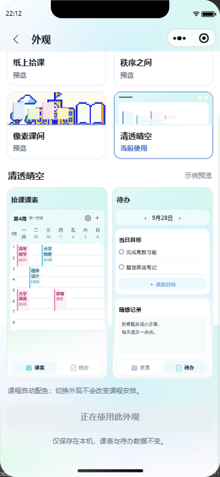
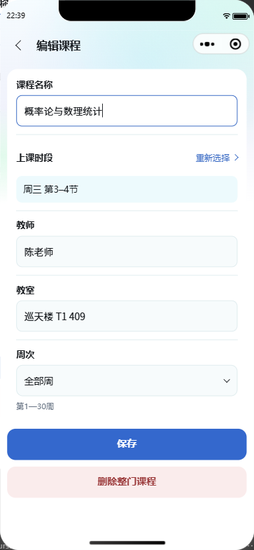
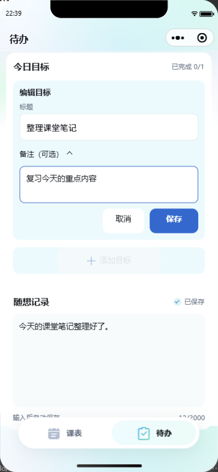

# 清透晴空主题实现与验收

## 范围与视觉标准

用户确认的[课表效果图](../assets/appearance/aqua/approved-timetable.png)是本轮视觉依据。新增 `aqua`“清透晴空”，并按用户同日进一步要求设为默认主题；首次启动或偏好缺失／异常时使用，已保存的有效选择继续保留。在“设置 → 外观”中可以预览并切换六套外观。新增主题覆盖全部12页及共用组件。

| 页面／组件 | 新主题实现 |
| --- | --- |
| 课表 | 浅青渐变、半透明周次区、真实教学周日期、横向虚线、浅彩课程色条 |
| 待办 | 轻透日期区、白色目标／随想面、月历圆形日期、原位编辑与拖动状态 |
| 设置、关于 | 连续白色菜单、主题图标、反馈与二维码原有操作 |
| 课程编辑、时段重选 | 浅青输入面、蓝色选择状态、统一课程几何 |
| 学期、作息、单节时间 | 白色圆角设置面、原生日期时间选择、保存状态 |
| 课表备份、待办备份 | 导出／导入／恢复前备份状态与主题空状态 |
| 外观 | 第六张主题卡、带日期与悬浮底栏的课表／待办合成预览 |
| 导航、底栏 | 实测系统安全区、固定标题、课表／待办两个悬浮入口 |

## 实现与数据边界

- `themes/index.ts` 集中主题变量、七色课程背景／色条／文字与13个本地SVG图标；背景天光使用固定尺寸，页面变长时不扩大渐变范围。
- `timetable-dates.ts` 通过已验证的学期和教学周构造七个本地日期；跨月／跨年同时显示两个月份，仅当前自然日显示今天标记。学年标签沿用既有七月秋季分界。
- `timetableMetrics` 统一课程卡、节次格与滑动容器的尺寸来源。原五套参数维持124／80／16／4，Aqua为140／120／0／0（节次、表头、上下内边距、卡片内缩，单位rpx）。Aqua使用CSS变量和 `calc` 在基础尺寸换算后乘节次数，避免小程序rpx独立取整造成累计偏移。
- 外观只写 `timetable_appearance`，保持版本1。课程V5、待办V3及两类备份格式不变；不增加示例课程或待办，不改变现有记录色位。
- 课表分享按钮沿用首页分享函数与路径，不携带本地课程／待办数据。原生微信胶囊、手机状态栏、系统日期／时间滚轮依设备呈现。

## 验证记录

### 代码与自动测试

- `npm.cmd --prefix wechat-timetable run check`：TypeScript检查与 **472项测试全部通过，0失败**。覆盖率为行85.11%、分支89.69%、函数87.15%。新增日期边界、外观恢复、业务存储隔离、草稿保留、设置返回周次及主题尺寸回归；取整模型覆盖320／360／375／390／393／430／768px宽度。
- 最终只读代码审核未发现实质Bug；旧五套的课程定位、表头与内边距仍走原有分支。所有12页及隔离组件均同步外观。
- UI检测器没有报告项；`git diff --check`通过。完整检查日志保留在本地忽略目录 `dist/aqua-check.log`。

### 微信开发者工具实际运行

环境：基础库 **3.17.2**，iPhone 12/13 (Pro)，**390×844逻辑尺寸**。

- 首轮检查全部12个Aqua页面，以及原五套主题的课表回归，共17个页面／主题组合、20张截图。两项交互检查最初因自动化超时和旧设置按钮选择器未通过；修正脚本后均在第二轮完成。
- 根据首轮截图集中修复分享按钮原生默认宽度挤压学期、课程卡片累计取整偏移，并调整渐变和窄屏控件。第二轮定向复核课表、待办、外观、时段选择4页及交互状态，共9项检查、10张截图，**全部通过**。
- 实际测量确认七列、教学周日期、课程跨度以及第13—14节末端课程均与行边界对齐；滚动到底部后再次测量通过。
- 月历42个日期、目标原位编辑／取消、课表多选状态、设置返回后保持第8周、课程与待办草稿在Aqua和paper切换后保留、两个底栏入口及至少44px触控尺寸均通过。
- 两轮均无运行时异常或清理错误。合成课程／待办使用内存存储替身；测试后恢复真实API和原外观偏好，**全部真实Storage键和值前后一致**。主题测试仅写合成外观偏好，合成课程和待办也保持不变。

详细原生报告在本地 `dist/aqua-review/report.json` 和 `dist/aqua-review-final/report.json`；共享摘要见[验收证据](screenshots/aqua-20261025/evidence.json)。第一轮中不受集中修正影响的页面结构／旧主题结果继续沿用，不把两轮截图数量当作独立页面数。

### 窄屏补充与验证边界

真实WXML／WXSS的浏览器布局代理在320／360／390／430px检查课表工具栏、待办日期操作、展开月历、60字编辑输入以及14节设置页底部，共 **20个组合全部通过**：无横向溢出、控件重叠或小于44px的目标。代理结果见本地 `dist/aqua-responsive-proxy/summary-after.json`，不能替代微信模拟器／真机。

多选和部分交互通过页面方法驱动，不据此宣称真实长按、滑动手势已验收。真机键盘、系统字号、iOS／Android实际性能和辅助功能表现仍需实机复核。以上为10月25日实现阶段的验收，当时未上传、发布、提交或推送；后续审核与发布安排见本文末尾。

## 实际运行截图

以下为第二轮微信开发者工具截图，使用合成课程与待办，原截图未修改；参考效果图不作为运行证据。系统刘海、状态栏和胶囊由模拟器呈现。

| 课表 | 待办 |
| --- | --- |
|  |  |

| 展开月历 | 外观合成预览 |
| --- | --- |
|  |  |

[时段选择截图](screenshots/aqua-20261025/aqua-slot-select.png) · [第14节底部截图](screenshots/aqua-20261025/aqua-timetable-period-14.png)

## 同日追加：输入与操作细节

根据用户指定的[评估AI聊天界面设计建议](codex://threads/01a1734e-1411-7633-b8ae-81a87b96a510)，采纳输入聚焦提示、稳定数字、克制反馈和局部减少重复描边；保持已确认的主题配色、课表几何和悬浮底栏。

- 课程名称、教师、教室，以及目标标题、备注、随想均在真实聚焦时显示强调色细线。焦点从一个输入移到另一个输入时，晚到的旧字段失焦事件不会清除新字段；关闭编辑、收起备注和离页都会清理视觉标记，草稿与自动保存仍沿用原规则。
- 待办原位编辑的外层改为浅青面与等宽透明边框，避免与当前输入框叠加蓝色线框。随想聚焦前后的内外尺寸保持稳定。用户要求移除的过期规则说明已删除，保留自动保存提示与字数。
- 周次数字预留两位宽度并使用等宽数字；日期、月历标题和计数补齐数字排版。课程、待办日期与三类设置页的选择器补充轻微按压反馈，Aqua保存按钮不再缩放，减少动态效果设置仍生效。
- 逐字模糊、暗色字重补偿、全局Grid折叠和统一图标偏移没有适用需求，本轮不引入；原五套主题保留自身视觉与反馈规则。

完整代码检查通过 **476项测试**（新增4项焦点行为回归），覆盖率为行85.18%、分支89.69%、函数87.36%。320／360／390／430px浏览器布局代理共28个组合通过；9→10周时相邻学期的横向位移最大0.02px。对应本地日志为 `dist/aqua-polish-check.log` 与 `dist/aqua-polish-responsive/report.json`。

390×844原生模拟器复核了1／9／10／30周的相邻控件位置、多选时周次不可用，以及学期、作息、单节时间设置的选择器和保存按钮按压。未出现控件缩放或尺寸变化。初轮脚本的属性选择器、属性类型和滚动坐标假设已修正，已通过的阶段沿用，不重复采图。

自动化 `Element.tap` 未将输入点击传递为原生focus，因此另外用Windows真实指针在开发者工具窗口点击，确认课程名称→教师、目标标题→备注和随想聚焦／失焦均正确更新强调色细边。课程输入保持340×48px，目标标题320×48px、备注320×66px，随想面板聚焦前后均为344×167px；旧输入会恢复常态。没有手动注入高亮类或伪造焦点通过。随想失焦立即保存与取消重复延迟写入由行为测试验证，真机键盘仍未验收。

追加验收结束后均恢复原偏好与全部真实Storage，键和值前后一致，无运行时异常或清理错误。真实点击记录共8个快照、5张未修改截图；[追加证据](screenshots/aqua-20261025/refinement/evidence.json)与原始本地报告 `dist/aqua-polish-manual/report.json` 对应。自动化按压报告保留在 `dist/aqua-polish-review/` 和 `dist/aqua-polish-review-retry/`。

| 课程输入聚焦 | 待办备注聚焦 |
| --- | --- |
|  |  |

[随想聚焦](screenshots/aqua-20261025/refinement/journal-focused.png) · [待办常态与保留的自动保存提示](screenshots/aqua-20261025/refinement/todo-refined.png)

## 同日追加：设为默认外观

按用户要求将 `DEFAULT_THEME` 改为 `aqua`，同步启动窗口、底栏兜底颜色和全局样式兜底。首次使用、缺失／无效偏好、读取暂时失败以及通用分享预览采用清透晴空；已保存的六套合法偏好继续恢复，读取失败时不覆写原偏好，恢复读取后仍使用原选择。

`npm.cmd --prefix wechat-timetable run check` 再次通过TypeScript与476项测试，0失败。回归覆盖默认回退、旧选择保留、读取异常恢复，以及分享预览不改变个人偏好；日志位于 `dist/aqua-default-check.log`。本次只改默认配置与对应文档／测试，未重新进行视觉截图验收。

## 2026-10-28：全部修改审核与发布准备

按用户要求审核当前工作区的全部代码、文档和新增资产，通过后直接更新 GitHub `main`。本次独立复核业务逻辑、界面样式和发布材料：默认回退与旧偏好保持、日期和课表几何、焦点生命周期、自动保存、主题隔离及资源路径均已检查。

审核发现并修复一处月历回归：Aqua 日期面的无边框样式遮蔽了未选中“今天”的标记。现保留等宽透明边框，以蓝色细环标记今天，选中日仍使用渐变底色；日期尺寸不变。使用实际全局／页面样式及主题变量，在 Edge 样式代理中检查320／390px、全部六套主题、普通／今天／选中／今天且选中四种状态；Aqua标记正确，原五套测得样式不变。本次没有追加原生模拟器或真机验收。

11张原生截图的SHA-256与证据文件一致，截图使用已声明的合成数据；13个新增SVG可解析且无脚本或外链，发布材料未发现密钥或令牌。本地完整检查通过TypeScript与476项测试，0失败，日志保留于忽略目录 `dist/aqua-publish-check.log`。发布范围包含所有已修改文件与未忽略的新文件；个人配置、依赖和本地临时验证产物继续遵守现有忽略规则。GitHub代码更新与微信平台上传／发布是不同操作，本次仅授权前者。
