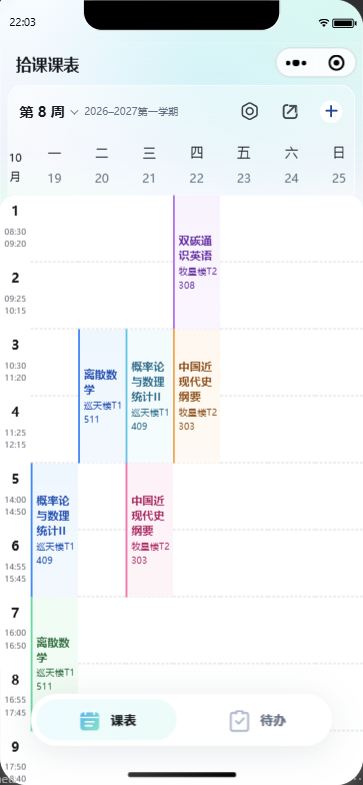
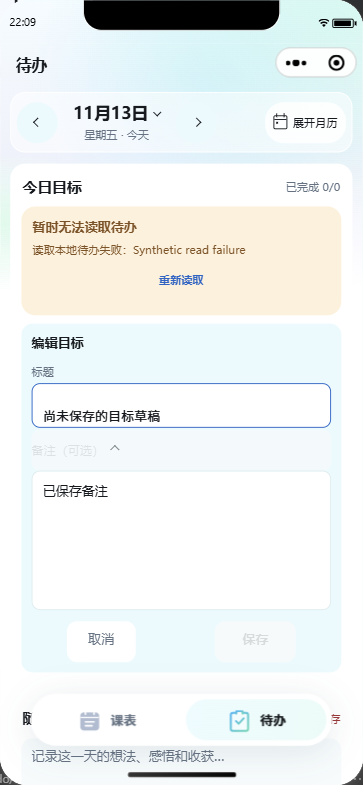

# 项目优化记录 · 2026-11-13

本次围绕现有课表、待办和本地备份流程优化数据传输、核心算法和异常交互。保留六套外观、原有功能与数据格式：课表 schema V5、待办 schema V3、两类备份封装 V1。未新增依赖。

## 课表与待办渲染

课表网格将选中状态与课程内容更新分离，点击单格仅发送该格的布尔值；主题、作息和课程变化仍重新计算对应网格。周面板仅构建当前与相邻周的日期，只更新实际变化的面板，保留相邻周预加载、课程编辑后的刷新和学期变化后的重建。

待办列表仅传输 `id/title/note/completed/expired`；时间戳、所属日期和旧版本兼容字段仍完整保存在 Storage。每日分组一次扫描完成，未完成／已完成分区内保留手动排序。底栏主题和安全区同步忽略未变化字段，不重发纹理与图标配置。

以下数值为 Node.js v24.19.0 下 JSON 序列化的 UTF-8 字节数，不代表真机延迟或帧率。

| 测量场景 | 优化前 | 优化后 | 减少 |
| --- | ---: | ---: | ---: |
| 20 门两节课程、14 节、30 周：选择一个空格 | 16,200 B | 38 B | 99.8% |
| 同一课表首次渲染第 15 周 | 38,539 B | 25,912 B | 32.8% |
| 同一课表从第 15 周切到第 16 周 | 38,539 B | 7,964 B | 79.3% |
| 上述课表构建的日期对象数 | 210 | 21 | 90.0% |
| 1,000 条中文目标，334 条已完成：列表载荷 | 206,563 B | 108,557 B | 47.4% |
| 同样目标带历史迁移字段：列表载荷 | 328,563 B | 108,557 B | 67.0% |

主题未变且路由未变时，重复 `onLoad/onShow/onReady` 不再产生底栏 `setData`；切换路由仅更新选中索引，主题变化时才更新整套外观字段。公开分享预览继续使用默认主题。

## 冲突与备份合并

冲突检测由两两扫描改为 7 天 × 14 节 × 30 周的占用索引，记录每个格子的最早占用者。返回的首对冲突仍按原数组顺序确定，旧版空周次数组仍表示全部周。输入先沿原流程校验，索引不取代输入合法性检查。

备份合并使用 ID／课程身份集合检查重复，使用星期节次的 30 周位图检查重叠。重复优先于冲突、整门课程跳过、原预览文案与导入事务保持一致。

本机 Windows x64、Node.js v24.19.0，预热后 21 次采样的每次调用中位值：

| 纯算法场景 | 优化前 | 优化后 |
| --- | ---: | ---: |
| 2,940 个不重叠的按周时段：冲突检测 | 9.1710 ms | 0.0191 ms |
| 2,941 个时段，末尾存在冲突 | 7.9684 ms | 0.0219 ms |
| 2,940 个时段与完全相同的本机课表：全部重复的合并规划 | 69.6660 ms | 0.9693 ms |
| 20 门常规课程：冲突检测 | 0.0003 ms | 0.0049 ms |
| 20 门常规课程：合并规划 | 0.0114 ms | 0.0115 ms |

小课表建立索引存在约 5 微秒固定开销；空课表与单课程直接返回。大型场景用于检查可接受数据范围的退化行为；合并测量针对全部重复场景，不泛化为所有导入情况。以上不含微信 Storage、页面渲染和设备桥接开销，不用于宣称整页加速倍数。

相同目标或随想再次保存时，仍重新读取并校验存储状态，但跳过无意义写盘、保留原更新时间；损坏数据和会话写入锁仍阻止写入。

## 异常交互修复

- 读取失败时，正在编辑的已有目标通过原有末尾表单继续显示草稿，输入与保存禁用，取消可用，避免用户无法解除恢复备份前的草稿阻塞。
- 随想“放弃修改”确认绑定页面生命周期与备份恢复版本；离页结束旧确认的暂停状态并执行原有保存流程，旧回调不能丢弃返回后草稿或解除新确认的暂停。
- 长按期间选择模式、操作权限或禁用格发生变化时，不再触发失效的选格事件。
- 底栏导航在等待键盘收起时绑定一次操作令牌；隐藏、卸载或重新显示后，旧回调不再跳转或解除新操作的锁。

## 验证与复现

```powershell
cd wechat-timetable
npm run check
npm run benchmark
```

`check` 执行 TypeScript 严格检查与全量测试。覆盖率最低线从行 67%／分支 77%／函数 70% 提升为 85%／89%／87%，不降低既有检查标准。

新增回归覆盖稀疏选格、切周与学期变更、失效长按、草稿恢复入口、随想确认生命周期、底栏去重与失效导航、无变化保存，以及固定种子的 500 组冲突差分和 200 组合并差分。另独立审查并执行 13,848 个冲突组合，与原算法结果一致。路径式 `setData` 测试 helper 同步模拟真实小程序数据更新。

四个基准脚本位于 `wechat-timetable/scripts/`，原算法仅保留在基准／差分测试中作对照；耗时不作为 CI 硬门槛。测量只使用合成数据。

原生模拟器验证使用工作区 `dist/project-optimization-20261113` 下的隔离游客项目与合成数据，不上传、不发布。

### 最终结果

- `npm run check`：TypeScript 检查通过，499 项测试通过、0 失败；行覆盖率 85.39%、分支 90.15%、函数 87.74%，通过提升后的门禁。
- `npm run benchmark`：四项可重复基准全部运行成功；完整本地输出在 `dist/optimization-benchmark-20261113.log`。
- 微信开发者工具 2.02.2608060、基础库 3.17.2、iPhone 12/13 (Pro) 模拟尺寸 390×844：课表／待办／外观／时段选择渲染、月历与原位编辑、14 节课程对齐、选格和底栏触控尺寸通过初次检查，截图已人工查看。
- 定向原生复核通过五组行为：设置返回保留第 15 周；六套主题经设置页切换后保留周次与格子选中状态；相邻与远距离切周显示正确日期和课程；读取失败后实际点击取消可退出草稿且原目标未改；底栏导航与安全区正确。
- 原生检查使用内存模拟 Storage；最终比较确认原 Storage 未变化、合成课程与待办未变化，未捕获运行时异常。隔离项目的 216 个运行时源文件与当前项目逐字节一致。
- 首次复用旧验收脚本遇到当前自然周与固定第 8 周的断言不符，以及导航等待问题；新的定向脚本使用明确导航参数、等待实际页面状态，并从设置页进入外观。读取失败测试中也修正了自动化接口返回字符串布尔值与事件异步完成的测试假设。上述是验收脚本修正，未据此改变产品行为；通过的检查范围见[验收摘要](screenshots/optimization-20261113/evidence.json)。

新增 `scripts/verify-native.cjs` 可复现上述五组原生行为。它不是 `npm run check` 的依赖，需要另行可用的 `miniprogram-automator` 与已开启自动化端口的隔离游客项目：

```powershell
$env:WECHAT_AUTOMATOR_MODULE = '已安装的 miniprogram-automator 包绝对路径'
$env:WECHAT_AUDIT_ENDPOINT = 'ws://127.0.0.1:9421'
node scripts/verify-native.cjs ../dist/optimization-native
```

定向复查可通过 `NATIVE_CHECK_FILTER` 按检查名筛选。测试以合成课表及目标运行，不能指向有未保存编辑的工作项目。Node 和开发者工具结果均不代替 iOS／Android 真机上的帧率、触摸手势、键盘或读屏验收；本次未上传微信预览、未发布线上版本。




